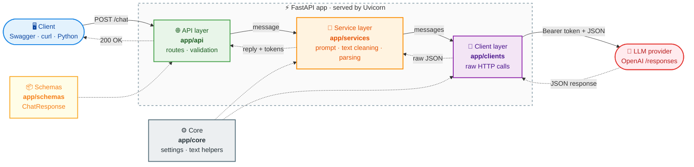
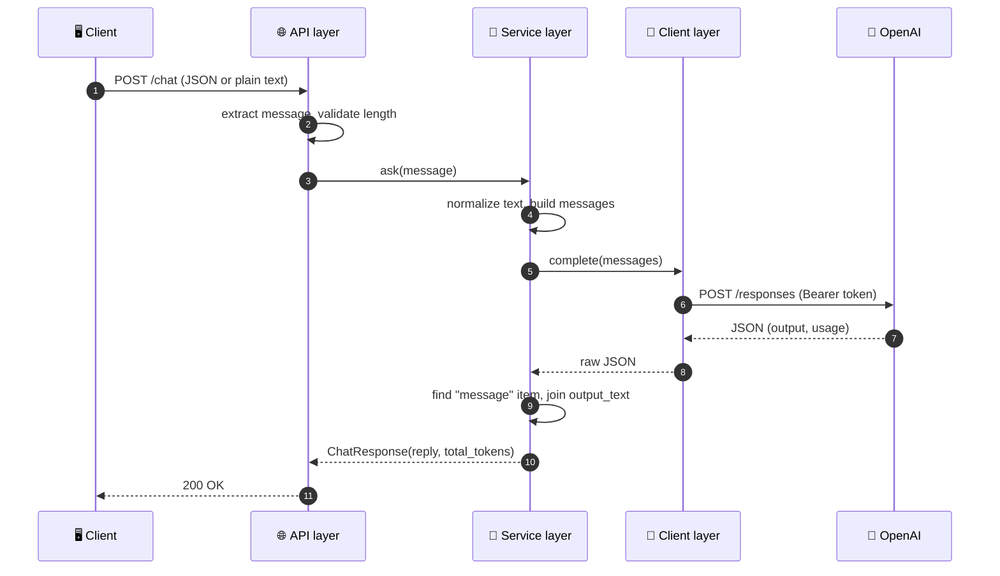

# Simple Summarizer


A small FastAPI service that summarizes text by calling an LLM provider (OpenAI Responses API) over plain HTTP. Built as a learning project to practice **LLM API integration** with a **layered architecture**.

## Features

- Single `POST /chat` endpoint that accepts text and returns an LLM-generated summary plus token usage
- Accepts JSON (`{"message": "..."}`) **or** plain text with real line breaks
- Layered design: API → Service → Client, with config and schemas kept separate
- Configuration and secrets loaded from `.env`
- Auto-generated interactive docs (Swagger UI)

## Architecture



**Legend:** solid arrows are the request going down, dotted arrows are the response coming back up. Core and Schemas are shared helpers used by the layers, not layers themselves.

<details>
<summary>Request sequence (click to expand)</summary>



</details>

| Layer | Folder | Responsibility |
|---|---|---|
| API | `app/api/` | HTTP in/out, input validation |
| Service | `app/services/` | System prompt, text cleaning, response parsing |
| Client | `app/clients/` | Raw HTTP calls to the provider |
| Schemas | `app/schemas/` | Response models |
| Core | `app/core/` | Settings and text helpers |

Each layer only talks to the one below it. To switch providers, only the client (request) and service (parsing) need to change.

## Project structure

```
simple_summarizer/
├── .env                  # local secrets (not committed)
├── .gitignore
├── requirements.txt
├── README.md
└── app/
    ├── main.py
    ├── core/
    │   ├── config.py     # Settings loaded from .env
    │   └── text.py       # normalize_text, extract_message
    ├── schemas/
    │   └── chat.py       # ChatResponse
    ├── clients/
    │   └── llm_client.py # HTTP call to the provider
    ├── services/
    │   └── chat_service.py
    └── api/
        └── routes/
            └── chat.py   # POST /chat
```

## Requirements

- Python 3.10+
- An API key from your LLM provider 

## Setup

```bash
# 1. Clone
git clone <your-repo-url>
cd simple_summarizer

# 2. Create and activate a virtual environment
python -m venv .venv
source .venv/bin/activate        # Windows: .venv\Scripts\activate

# 3. Install dependencies
pip install -r requirements.txt
```

## Configuration

Create a `.env` file in the project root:

```dotenv
LLM_API_KEY=sk-your-key-here
MODEL_NAME=preferred model
# Optional (defaults to OpenAI):
# LLM_BASE_URL=https://api.openai.com/v1
```

| Variable | Required | Description |
|---|---|---|
| `LLM_API_KEY` | Yes | Provider API key |
| `MODEL_NAME` | No | Model to use (default set in `app/core/config.py`) |
| `LLM_BASE_URL` | No | Provider base URL (default `https://api.openai.com/v1`) |

Never commit `.env`. It is listed in `.gitignore`.

## Run

```bash
uvicorn app.main:app --reload
```

Run it from the project root. `--reload` restarts on code changes (development only). After editing `.env`, stop and restart the server manually.

Open the interactive docs at **http://127.0.0.1:8000/docs**.

## Usage

### JSON

```bash
curl -X POST http://127.0.0.1:8000/chat \
  -H "Content-Type: application/json" \
  -d '{"message": "Text to summarize goes here."}'
```

### Plain text with line breaks

```bash
curl -X POST http://127.0.0.1:8000/chat \
  -H "Content-Type: text/plain" \
  --data-binary @article.txt
```

Use `--data-binary`, not `-d`, so newlines in the file are preserved.

### Python

```python
import requests

text = """First paragraph.

Second paragraph."""

r = requests.post("http://127.0.0.1:8000/chat", json={"message": text})
print(r.json())
```

### Response

```json
{
  "reply": "A short summary of the text.",
  "total_tokens": 150
}
```

`total_tokens` includes reasoning tokens when the model uses them.

### Errors

| Status | Cause |
|---|---|
| `422` | Empty message, or longer than 20,000 characters |
| `500` | Provider call failed (check the server log for the traceback) |

## How it works

1. The route reads the raw request body and extracts the message (JSON or plain text).
2. The service normalizes line endings and blank lines, then builds the prompt with a summarizer system prompt.
3. The client sends `POST {LLM_BASE_URL}/responses` with a Bearer token and `{"model": ..., "input": [...]}`.
4. The service finds the `message` item in the response `output`, joins its `output_text` blocks, and returns the reply with `usage.total_tokens`.

## Possible next steps

- Error handling: map provider failures to clean `502` responses
- Logging and token/cost tracking
- Tests using a fake client (the service accepts any client via constructor injection)
- Conversation history and streaming
- Official `openai` SDK in place of `requests` (only `llm_client.py` would change)

## License

This project is licensed under the [MIT License](LICENSE).
